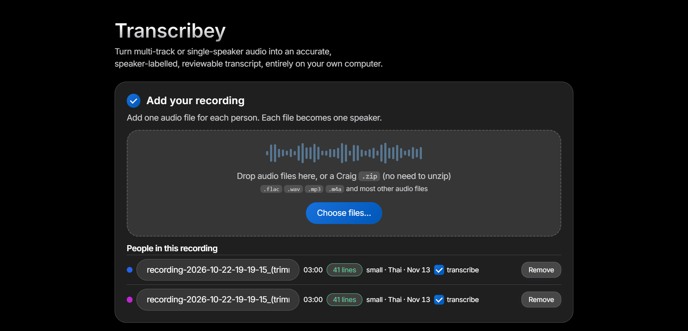
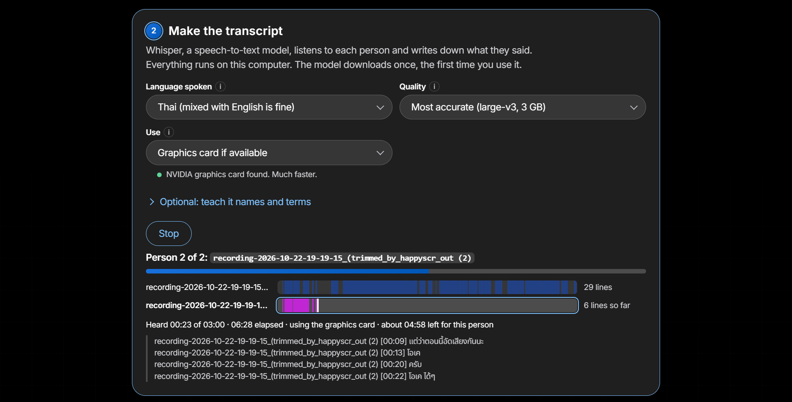
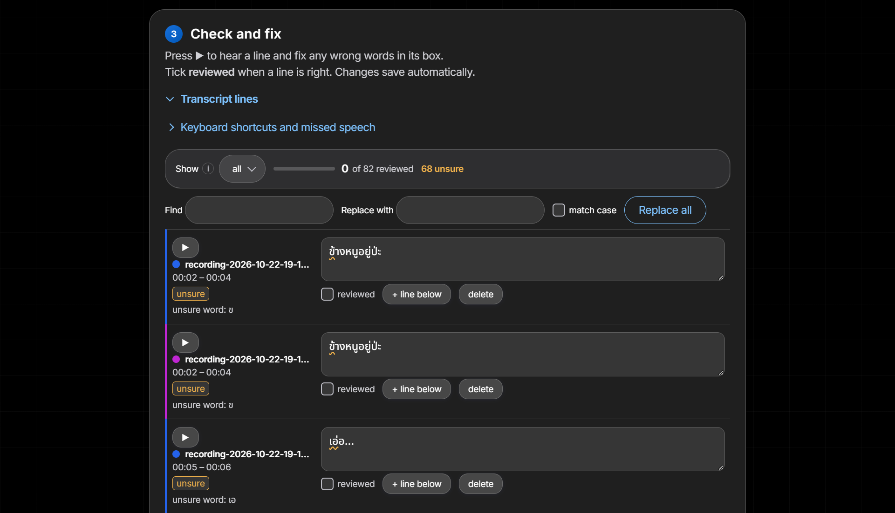

<div align="center">

# Transcribey

**Turn multi-track or single-speaker audio into an accurate, speaker-labelled, reviewable transcript, entirely on your own computer.**

[Overview](#overview) • [Features](#features) • [Getting started](#getting-started) • [Usage](#usage) • [Choosing a model](#choosing-a-model) • [Development](#development) • [Troubleshooting](#troubleshooting)

</div>

## Overview

Transcribey transcribes multi-track or single-speaker audio using [faster-whisper](https://github.com/SYSTRAN/faster-whisper) and merges the output in time order. Each audio file represents one speaker, labelling lines directly without diarization. A browser review screen lets you listen and edit line by line. Supports Craig multi-track Discord `.zip` exports and standalone audio files.

> [!NOTE]
> Everything runs locally on your computer. Audio, transcripts, and models never leave your machine. Not affiliated with Craig or OpenAI.

### Language support

Tuned for **Thai and English**, including mixed speech:
- Optional Thai models transcribe Thai speech only.
- Line segmentation respects Thai script (no spaces between words).
- Characters outside Thai and Latin alphabets are flagged as unsure.
- Other languages run through **Detect automatically** (untested; non-Latin and non-Thai scripts are marked unsure).

## Features

- **Multi-track input**: Craig `.zip` archives or individual audio files (FLAC, WAV, MP3, OGG, Opus, M4A). One track per speaker.
- **Local transcription**: Whisper models (`small` to `large-v3`) running on NVIDIA GPUs (CUDA 12) with automatic CPU fallback.
- **Thai and English tuned**: Optimized segmentation and vocabulary hints for mixed speech.
- **In-browser review**:
  - Floating player with speed controls, looping, and auto-advance.
  - Shortcuts: `Alt+Enter` to mark reviewed and advance; `Alt+↓` to jump to unsure lines or missed speech.
  - Filters: **all**, **unsure**, **not reviewed**, and **TH/EN**.
  - In-page search and replace.
- **Safe editing**: Automatic saving to disk, confirmation before closing with unsaved edits, and non-destructive re-runs.
- **Export formats**: Export to `.txt`, `.srt` subtitles, or `.json`.

## Getting started

Run Transcribey via Docker (bundles `large-v3`) or with Python directly.

### Option 1: Docker

Prerequisites: [Docker](https://docs.docker.com/get-docker/), plus an NVIDIA GPU with the [NVIDIA Container Toolkit](https://docs.nvidia.com/datacenter/cloud-native/container-toolkit/install-guide.html) for GPU acceleration.

```bash
# Build the image (omit --build-arg GPU=1 for CPU only)
docker build --build-arg GPU=1 -t transcribey .

# Run the container (omit --gpus all on CPU-only machines)
docker run --init --rm --gpus all -p 127.0.0.1:8765:8765 -v transcribey_data:/data transcribey
```

Open http://127.0.0.1:8765. Transcripts persist in the `transcribey_data` volume.

> [!IMPORTANT]
> Keep `127.0.0.1:` in `-p`. The server has no authentication; exposing it to other interfaces lets anyone on your network access your transcripts.

### Option 2: Python

Prerequisites: [Python](https://www.python.org/downloads/) 3.9+ (and CUDA 12 drivers for NVIDIA GPU acceleration).

```bash
python3 -m venv .venv
source .venv/bin/activate        # Windows: .venv\Scripts\activate
pip install .
pip install ".[gpu]"             # optional, for NVIDIA GPUs
transcribey                      # or: python -m transcribey
```

The browser opens at http://127.0.0.1:8765. Work is saved to `transcribey_work/`.

| Flag | Default | Description |
|---|---|---|
| `--port` | `8765` | Port to listen on |
| `--host` | `127.0.0.1` | Address to listen on |
| `--data` | `transcribey_work` | Data folder for audio copies and project files |
| `--no-browser` | | Do not open the browser automatically |

## Usage

1. **Add your recording.** Drop in a Craig `.zip` or audio tracks. Each file becomes a speaker you can rename.

   

2. **Make the transcript.**
   - Pick the language, quality (model), and device, then click **Start transcribing**.
   - Optionally add vocabulary hints to guide spelling for names and technical terms.
   - Progress, estimated remaining time, and recent lines stream live.

   

3. **Check and fix.**
   - Open **Transcript lines** once transcription finishes.
   - Click ▶ to listen, correct mistakes in place, and tick **reviewed** (or press `Alt+Enter`).
   - Use the **unsure** filter and `Alt+↓` to inspect low-confidence words (underlined) or anomalous lines (repetition, non-Latin/Thai text).
   - Dashed **Missed speech** rows mark detected speech without lines. Click **+ add line here** to create a line, or **transcribe this part again** to re-run that segment.

   

4. **Save your work.** Download the transcript as `.txt`, `.srt`, or `.json`.

   

## Choosing a model

| Model | Download | Notes |
|---|---|---|
| `small` | ~0.5 GB | Default for CPU; fast |
| `medium` | ~1.5 GB | Balanced; slower on CPU |
| `large-v3-turbo` | ~1.6 GB | Fast, near `large-v3` accuracy |
| `large-v3` | ~3 GB | Most accurate; default with GPU (~6 GB VRAM) |
| `typhoon` | ~6 GB to install, ~3 GB after | Thai only: [Typhoon Whisper Large v3](https://huggingface.co/typhoon-ai/typhoon-whisper-large-v3) |
| `pathumma` | ~3 GB | Thai only: [Pathumma Whisper Large v3](https://huggingface.co/PogusTheWhisper/Pathumma-whisper-th-large-v3-natural-noise-finetuned), noise tuned |

Enter custom Hugging Face CTranslate2 repositories or local folders under **Use a different model**.

### Installing a Thai model

Thai models require a one-time conversion:

```bash
pip install ".[convert]"
python -m transcribey.convert_model typhoon     # or: pathumma
```

Models save to `transcribey_work/models/<name>/`. For Docker, mount the folder with `-v "$PWD/transcribey_work/models:/data/work/models:ro"`.

## Development

```bash
pip install -e ".[dev]"
python -m unittest discover -s tests       # run tests
bash scripts/check.sh --fix                 # lint and format (ruff, Biome, Prettier)
git config core.hooksPath .githooks        # set up pre-commit hook
```

| Path | Purpose |
|---|---|
| `src/transcribey/__main__.py` | CLI entry point and server startup |
| `src/transcribey/project.py` | State persistence, review rules, exports |
| `src/transcribey/transcribe.py` | Engine worker, Whisper loading, background jobs |
| `src/transcribey/server.py` | HTTP server, API routes, Range audio streaming |
| `src/transcribey/static/` | Frontend assets (reloaded on refresh, no build step) |
| `src/transcribey/convert_model.py` | Model converter for Thai weights |

Static files in `static/` reload on browser refresh. Python changes require restarting the server.

## Troubleshooting

- **No NVIDIA graphics card found**: Ensure the card supports CUDA 12 and drivers are installed. With Docker, verify `--build-arg GPU=1` and `--gpus all`.
- **GPU out of memory**: Transcribey automatically falls back to CPU. To stay on GPU, pick `large-v3-turbo` or `medium`.
- **Port already in use**: Start with `--port 8766` or adjust Docker port mapping (`-p 127.0.0.1:8766:8765`).
- **Reset data**: Click **Start over** in the UI, delete `transcribey_work/`, or remove the Docker volume (`docker volume rm transcribey_data`).

## Credits

Self-hosted fonts under SIL Open Font License 1.1: [Inter](https://rsms.me/inter/), [Noto Sans Thai](https://fonts.google.com/noto/specimen/Noto+Sans+Thai), and [JetBrains Mono](https://www.jetbrains.com/lp/mono/). See `src/transcribey/static/FONTS-LICENSE.txt`.
